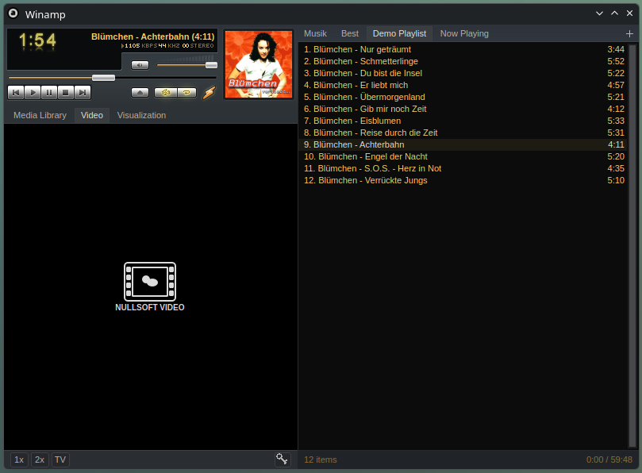

# Bento Interface Plugin for Audacious

    Build using build.sh.
    Move bento.so to /usr/lib/audacious/General/ (build.sh includes instructions for this)

    
## Screenshots

  

## Troubleshooting

Only tested on Arch.
    
